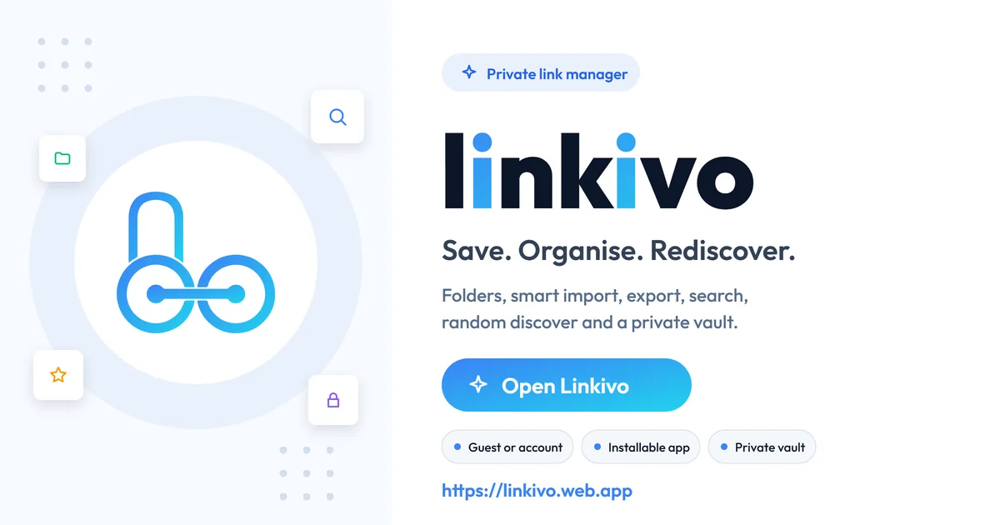
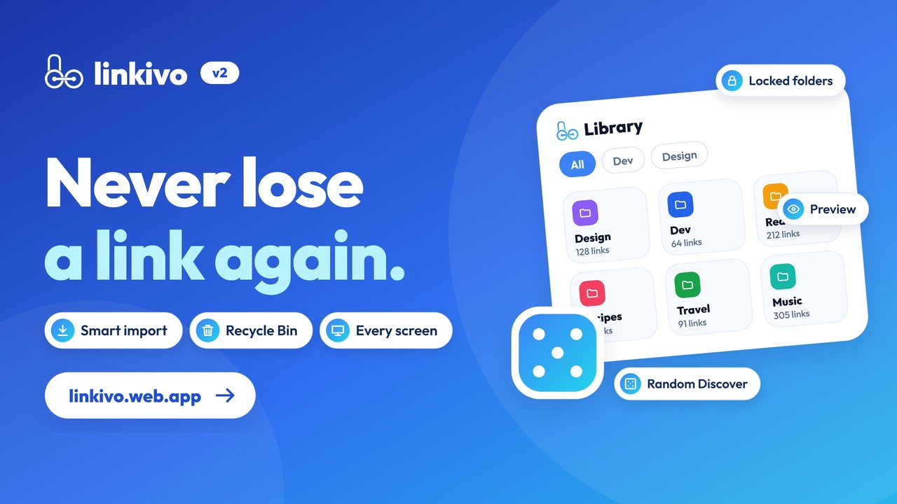
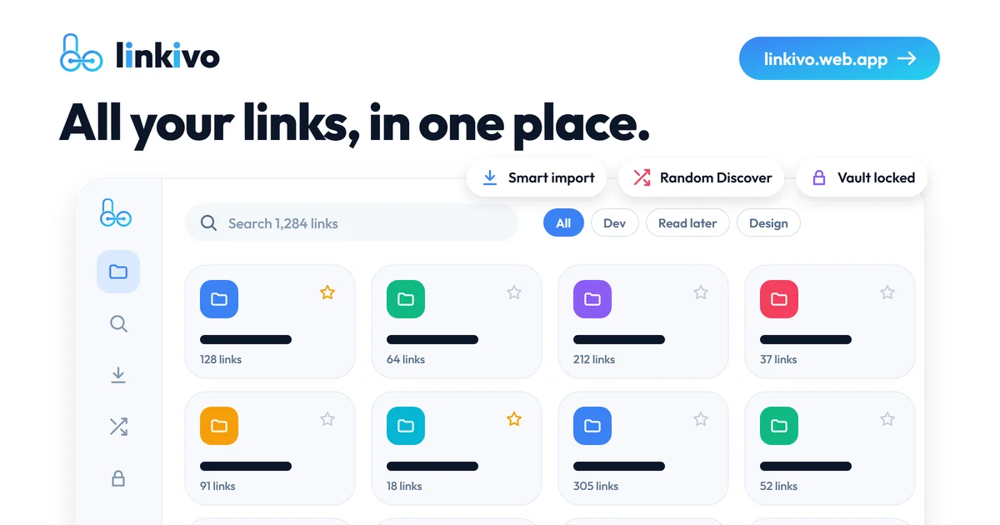
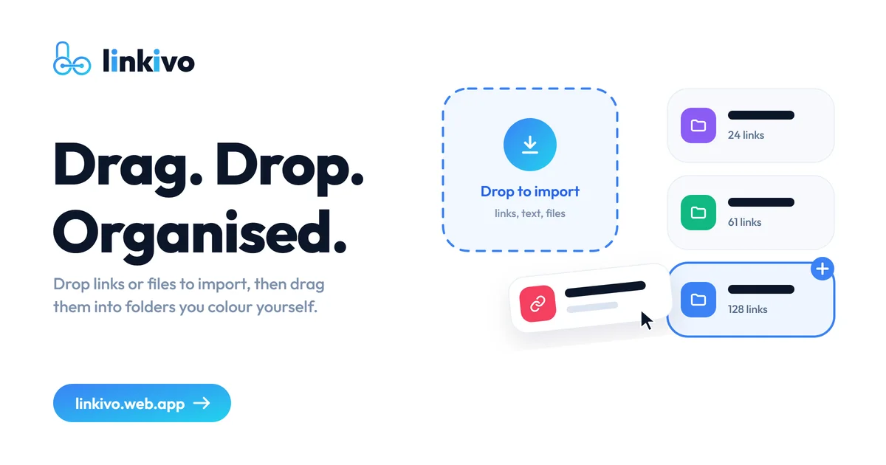
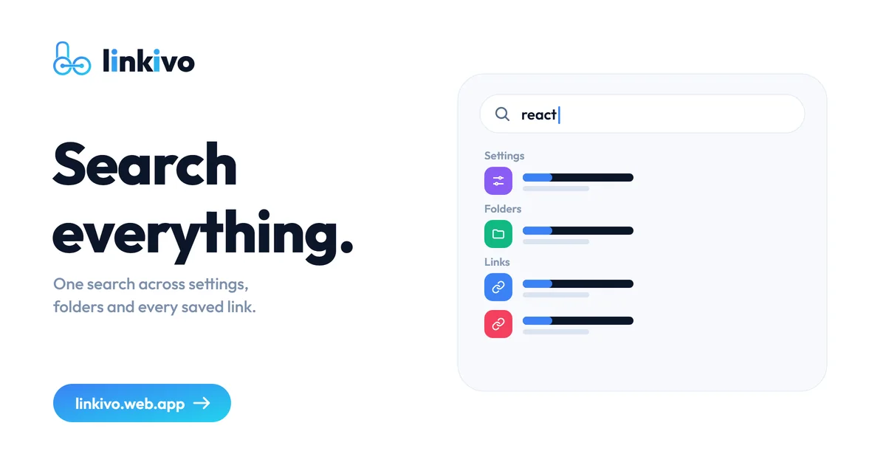
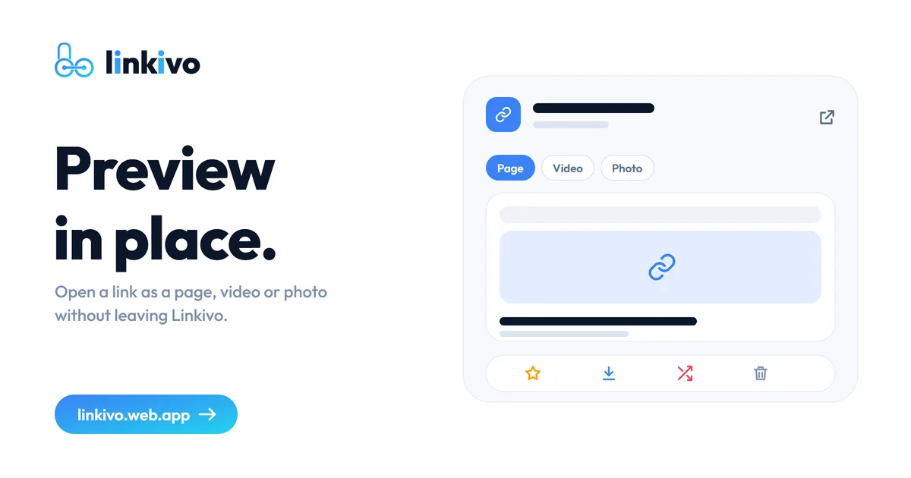
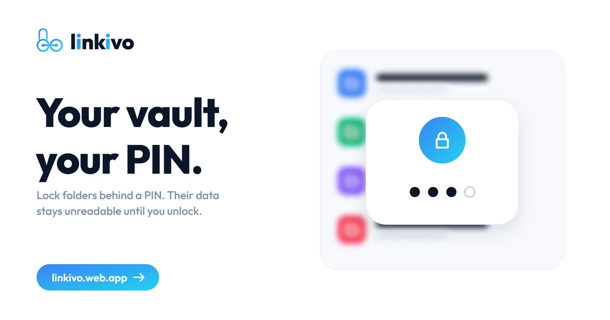
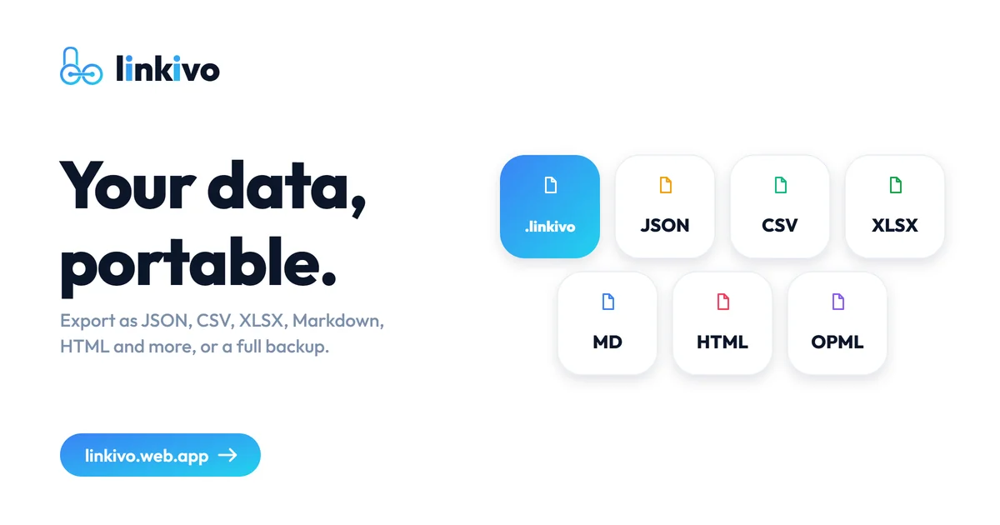
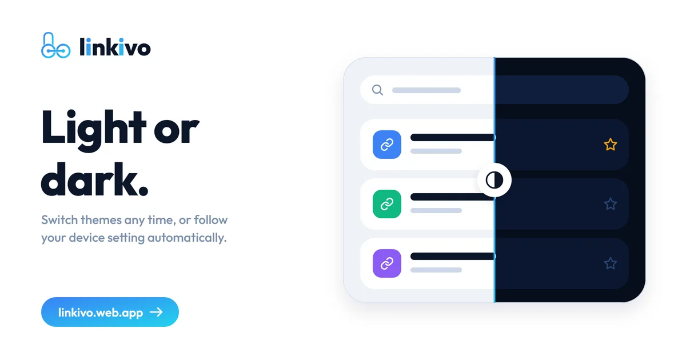

<p align="center">
  <a href="https://linkivo.web.app"></a>
</p>

<h1 align="center">Linkivo</h1>
<p align="center"><strong>A fast, private link manager for people with hundreds or thousands of links.</strong><br>
Folders, smart import, instant search, random rediscovery, locked folders and export in any format.<br>
Free. Runs in the browser or as an installed app.</p>

<p align="center"><a href="https://linkivo.web.app"><strong>Open Linkivo</strong></a> &nbsp;|&nbsp; <a href="https://linkivo.web.app/docs">Documentation</a> &nbsp;|&nbsp; <a href="https://linkivo.web.app/privacy">Privacy</a></p>

---

## Watch the introduction

<p align="center"><a href="https://youtu.be/0HaYeR6w6k0"></a><br><sub>A short tour of Linkivo. Opens on YouTube.</sub></p>

## What it does

| | |
|---|---|
| **Folders and links** | Colour and icon folders, pin, merge and duplicate them. Tags, favourites, read later, bulk actions with Undo, a Recycle Bin that keeps deleted items for 15 days. |
| **Smart import** | Paste any text or add files: links are found, cleaned, de-duplicated and saved in fast parallel batches. It survives a reload and can be undone. Titles and pictures are fetched afterwards. |
| **Search** | One search across links, folders and settings (Ctrl or Cmd + K). Instant on thousands of links. |
| **Preview** | Open a link as a page, video or photo without leaving Linkivo. |
| **Random Discover** | A surprise link from your own library, weighted by what you like, so old saves come back. |
| **Locked folders** | Hide folders behind a separate code. Locked folders are in no list, search, history or export until you unlock them, and the server enforces it. |
| **App lock** | A PIN on every start. The PIN is checked on the server; your data is also closed there until it is entered. |
| **Export and backup** | PDF, Excel, CSV, JSON, Markdown, text, HTML bookmarks, printable page and OPML, plus a full Linkivo backup that you can protect with a passphrase and restore in seconds. A backup reminder helps you not to forget. |
| **Works your way** | Guest mode (everything stays on your device) or an account (Google or email) that syncs. Works offline. Light and dark theme, six accent colours, phone and desktop layouts. |

<table>
  <tr>
    <td width="50%"><br><sub>Library and folders</sub></td>
    <td width="50%"><br><sub>Smart import</sub></td>
  </tr>
  <tr>
    <td><br><sub>Search everything</sub></td>
    <td><br><sub>Preview in place</sub></td>
  </tr>
  <tr>
    <td><br><sub>Random Discover</sub></td>
    <td><br><sub>Locked folders</sub></td>
  </tr>
  <tr>
    <td><br><sub>Export and backup</sub></td>
    <td><br><sub>Light and dark</sub></td>
  </tr>
</table>

## Quick start

1. Open **https://linkivo.web.app**. Choose **Continue as guest** to try it at once, or sign in to sync across devices. A guest can sign in later and move everything into the account.
2. **Install it** from the banner (or your browser menu, "Install app") to use it like a normal app, offline too.
3. **Import** your links from **Import**: paste text, or add files and browser bookmark exports.
4. **Back up** from the export popup (**Linkivo backup**). Do this now and then, especially as a guest, because a guest's links live only on that device.
5. For privacy turn on **App lock** or **Folder Lock (Vault)** in **Settings > Security**. Each opens a popup; locking a folder is in the menu of the folder.

Full guide: [linkivo.web.app/docs](https://linkivo.web.app/docs).

## Privacy and security

- Your links are stored in **your** account (or only on your device as a guest). They are never sold, shared or used for ads.
- Access is enforced by **database rules**, not by the screen. With the app lock on, the server refuses reads until the PIN is verified.
- PINs and codes are **never stored in plain text**: they are hashed with a secret pepper on the server (a Cloudflare Worker), with a shared lockout against guessing.
- Locked folders live under their own database path that needs a separate server session. While locked they are not in memory, cache, search, history or exports on your device.
- Backups can be encrypted in your browser (AES-GCM, key from your passphrase with PBKDF2). Linkivo cannot recover a lost passphrase.
- No secrets are in this repository. The Firebase web config is public by design.

## Built with

| Part | Choice |
|---|---|
| App | Plain JavaScript (ES modules), no framework and no build step, installable PWA |
| Data | Firebase Authentication and Realtime Database (Spark plan), local cache with delta sync, optimistic UI, jobs that resume after a reload |
| Server | One Cloudflare Worker (free plan): page details and pictures, PIN and vault sessions, background title fetching |
| Hosting | Firebase Hosting with a network-first service worker, so updates arrive by themselves |
| Quality | `@ Creator/tools/check.mjs` quality gate and 400+ automated tests (`node:test`) |

Everything runs on free plans.

## Run, test and deploy

```bash
node "@ Creator/tools/check.mjs"            # quality gate: syntax, secrets, deploy safety, generated files
node --test "@ Creator/tests/"*.test.mjs    # tests (jsdom is installed outside the project)
node "@ Creator/tools/gen-seo.mjs"          # rewrite the static SEO pages after changing page text
firebase deploy                              # hosting and database rules
```

The Cloudflare Worker (`@ Creator/worker/worker.js`) is pasted into the Cloudflare dashboard. Step by step, with every secret: [`@ Creator/docs/SETUP-GUIDE.md`](%40%20Creator/docs/SETUP-GUIDE.md).

## Project map

| Path | What it is |
|---|---|
| `index.html`, `sw.js`, `manifest.webmanifest`, `app.json` | shell, service worker, install info, version |
| `css/`, `js/`, `assets/` | the app, split by page and function (`js/core`, `js/engine`, `js/ui`, `js/features/*`) |
| `docs.html`, `terms.html`, `privacy.html`, `login.html`, `docs/` | generated static pages with their own SEO tags (`gen-seo.mjs`) |
| `@ Creator/` | plan, rules, features, architecture, design, testing, tools, Worker, database rules and the version history ([start here](%40%20Creator/README.md)) |

## Author

Made by **Muhtasim Rahman (Turzo)**, a student developer in Bangladesh.
[GitHub](https://github.com/muhtasim-rahman) | [Portfolio](https://mdturzo.web.app) | linkivo.web@gmail.com
